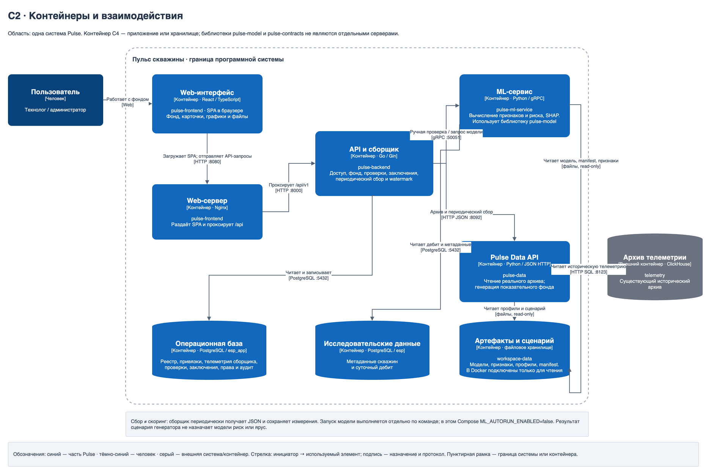
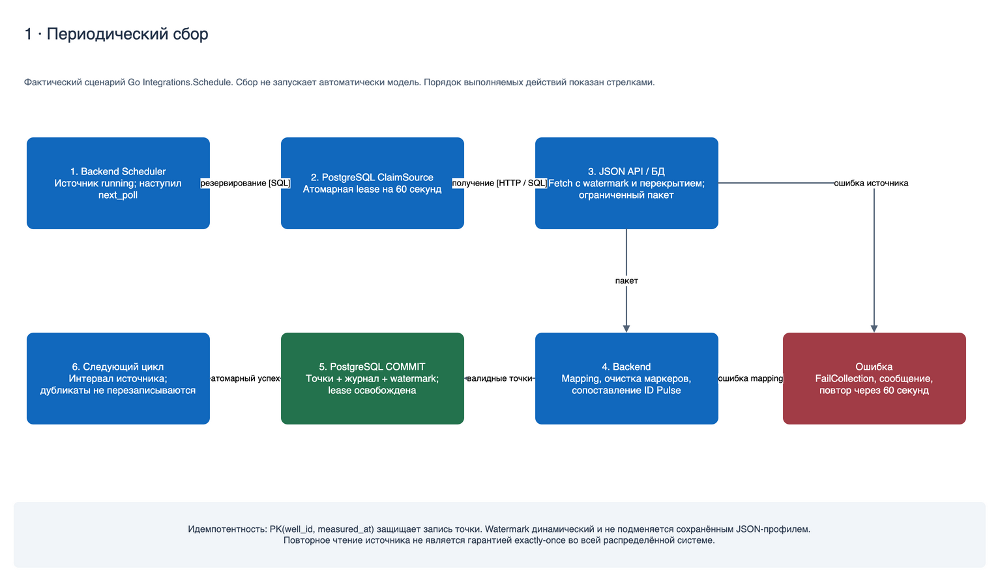
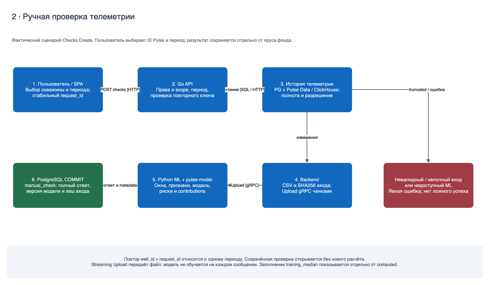
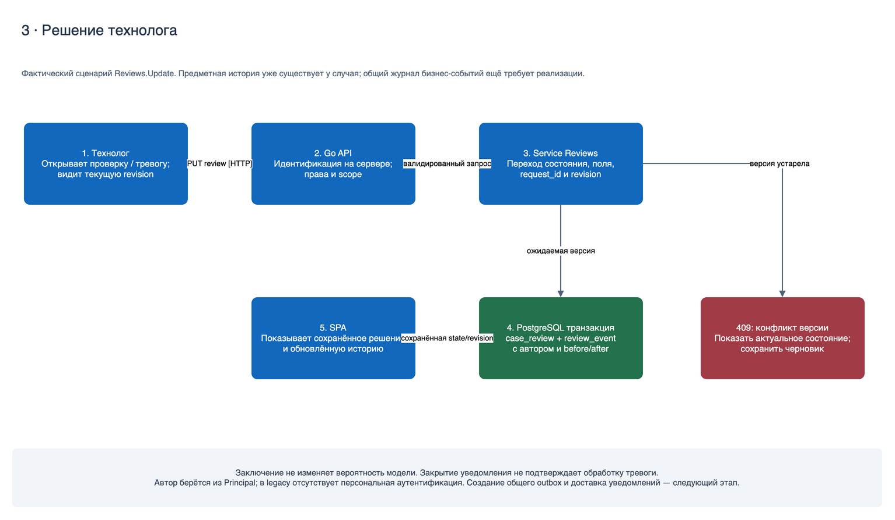

# Архитектура и взаимодействие приложений

C2/1: CollectionJobs→CollectionJobStore хранит immutable intent/capture, source
hold, dedicated physical PG ownership и shared protected writer. One Apply атомарно
пишет measurements/checkpoint/coverage/terminal/inbox; Rabbit — opaque wakeup,
PostgreSQL — authority/work truth. C2 не вызывает ML/Data snapshot API. Core47 и
SamplerSuccessDeadline30 source APPROVED/78controls; ACT14 runtime VERIFIED, publication PASS.
[Протокол](../references/q2-collection-jobs.md), [editable C4](../diagrams/q2-collection-jobs.drawio).

Own harness: sole fixedstdio, exact-owned Engine counters1s/fresh3s, streaming64KiB
SHA, guarded optionalworker2 retirement и complete current∪retired logs. Finite8
Consume может требовать external new-process restart. Authority faults проверяют
real≥7s lateI/O; source PUT draft восстанавливается statusPATCH с temporary exact-source
running next_poll guard, finally cleanup. Это test-only infrastructure, не product
schema/API/trigger/globalpause change. Fresh full A01–A11 после diagnostics обязателен.

Q1 source реализует input+quota+job+outbox одной PG tx и result+terminal job+inbox
одной fenced tx. Go worker получает trusted persisted intent/current rights,
не browser Principal; RabbitMQ переносит opaque references. Private FileSavedCheck
`q1_<jobID>` не является ManualCheck; отдельный review kind `file_check`.
[Протокол](../references/q1-file-jobs.md), [C4](../diagrams/q1-file-jobs.drawio),
[actual proof](../references/q1-runtime.md). At-least-once delivery/compute допускает
повторы, accepted effect один. Это implemented default-off synthetic source,
не развертывание на PREP/production.

Q0 добавил внутренний stored-file module: bounded CSV/XLSX → immutable raw/canonical snapshot/schema12 → strict typed `UploadPinned`, с отдельным verified registry. [Q0 architecture](../references/q0-architecture.md), [C4](../diagrams/q0-artifact-pinning.drawio) и [RUN-2 proof](../references/q0-runtime.md) различают implemented primitives, synthetic13PASS и будущую Q1 композицию. В историческом Q0 async routes/job/outbox/worker отсутствовали; текущий Q1 описан выше, legacy sync flow ниже сохранён. Source/runtime/reproducer ACCEPTED; final docs/publication gate PASS; actual PREP schema12 activation не заявляется.
## Представления C4

Для проверенного локального O2-пилота доступны [архитектура/budgets](../references/o2-architecture.md) и [редактируемая O2 C4](../diagrams/o2-observability.drawio). Optional diagnostics не меняет бизнес-владение PostgreSQL/ML и не является брокером jobs; финальная runtime-приёмка отмечается в [evidence](../references/o2-runtime.md). Базовые PREP/O1 схемы ниже сохраняют историческую область. Grafana-only UI bridge — прямо согласованное локальное egress исключение, не политика production.

[Редактируемый файл draw.io](../diagrams/pulse-c4.drawio) содержит C1 (контекст), C2 (контейнеры), C3 (компоненты backend) и Deployment локального Docker. Контейнер C4 — приложение или хранилище; его нельзя автоматически отождествлять с Docker-контейнером. Deployment является дополнительной диаграммой, а не уровнем Code. [Описание нотации C4](https://c4model.com/diagrams).

## Границы ответственности

| Элемент | Ответственность | Вход / выход |
|---|---|---|
| React SPA | Работа технолога, фильтры, графики, файлы и состояния интерфейса | HTTP JSON к `/api/v1` |
| Nginx | Статика SPA, history fallback, проксирование API | HTTP :80 внутри Docker |
| Go backend | Реестр, доступ, интеграции, сохранение проверок, заключения, задания, аудит | HTTP :8000; клиент gRPC; SQL |
| Pulse Data | Архив телеметрии и инженерный генератор обезличенного фонда | JSON HTTP :8092; чтение ClickHouse |
| ML-сервис | Bundle-only Upload для cohort; отдельно research Score/History | gRPC :50051; bundle-only не требует research cache/manifest/PG |
| pulse-model | Канонизация, гигиена, признаки, обучение, оценка и модели | Python-библиотека и исследовательские CLI |
| pulse-contracts | Единственный источник protobuf и generated Go/Python SDK | Зависимость сборки backend и ML |
| PostgreSQL esp_app | Операционное состояние приложения | Реестр, сеансы, проверки, сбор и истории |
| PostgreSQL esp | Исследовательские метаданные и суточный дебит | Чтение ML и загрузчики данных |
| ClickHouse telemetry | LONG-архив измерений | Чтение Pulse Data/исследовательских адаптеров |
| workspace-data | Модель, признаки, манифест, сценарии и отчёты | Общее хранилище, не репозиторий кода |
| pulse-landing | Статический сайт и интерактивный прототип | Не участвует в обработке рабочей телеметрии |

## Основные потоки

1. Браузер загружает SPA из Nginx. Запросы `/api/v1` проксируются к Go API.
2. Backend разрешает ID Pulse и scope. Читает операционную БД, а при необходимости — историю через Pulse Data.
3. Сборщик резервирует источник lease, читает пакет JSON/БД, применяет mapping/гигиену и атомарно сохраняет измерения, журнал и watermark.
4. Ручная проверка читает заданный период телеметрии, формирует CSV, вычисляет SHA256 входа и вызывает gRPC Upload. Результат с идентификатором модели сохраняется в `manual_check`.
5. Технолог меняет решение отдельной операцией; версия и предметное событие сохраняются в одной транзакции. Это не пересчитывает риск.
6. В cohort-профиле прогон фиксирует profile/cohort_version при BeginCohort и использует PostgreSQL advisory lock, затем ReadApp → telemetryCSV → Upload по участникам. Полный output snapshot, тревоги и terminal state записываются атомарно. Отдельный research-профиль сохраняет прежний Score; он не подменяет пользовательский bulk.

Сбор по расписанию не запускает автоматически скоринг каждого пакета. Streaming Upload — передача файла чанками, а не онлайн-обучение и не обработка каждого измерения без окна. Research ML-контекст может строиться лениво по запросу; bundle-only Upload от него отделён; `ML_AUTORUN_ENABLED=false` отключает ежедневный плановый прогон, но не всякое вычисление по запросу.

## Зависимости кода

`pulse-data → pulse-model`; `pulse-ml-service → pulse-model + pulse-contracts`; `pulse-backend → pulse-contracts`. Frontend использует HTTP API; отдельного прямого доступа к БД, ClickHouse или ML у браузера нет. Model не импортирует Data. Повторение имени Python-пакета `scripts` в model/data учитывается при editable-установках; запускать команды следует из соответствующего репозитория.

## Изменения архитектуры

[Варианты развития](17-decisions.md) описывают RabbitMQ/Kafka, SSO и Kubernetes как ещё не подключённые возможности. Они не добавлены в диаграмму фактического локального запуска. Дополнительная [диаграмма сценариев](../diagrams/pulse-flows.drawio) раскрывает сбор, проверку и принятие решения технологом.

## Сценарии взаимодействия

Все три схемы редактируются в [pulse-flows.drawio](../diagrams/pulse-flows.drawio).

## Архитектурное дополнение PREP

Диаграммы C4 выше сохраняют исходную дату и не доказывают переключение runtime. Принятый cohort/provenance seam и уточнения review/browser описаны в [PREP architecture](../references/readiness-architecture.md); [редактируемый draw.io](../diagrams/readiness-architecture.drawio) включён отдельно. FundScope объединяет membership и RBAC, typed DecisionRule сохраняет различные политики, PG хранит immutable output. Текущий alert linkage/status добавляется только на чтении как mutable overlay и не входит в output digest. Полный replay не заявляется без неизменяемых входов.
