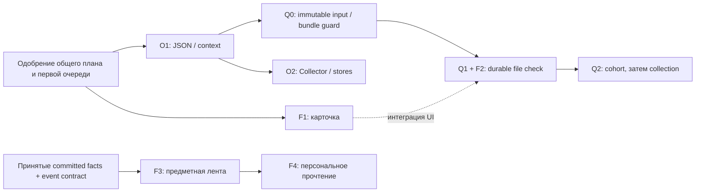

> Снимок документа 20.10.2026. Источник: `pulse-backend/docs/functional-roadmap-2026-10-20.md`; связь и владелец — `inventory/snapshot-sources.json`. Ссылки локализованы для автономного пакета.

# Pulse: общий план функционала, наблюдаемости и надёжных заданий

**O2 · реализация и runtime проверены, 20.10.2026:** source Go/Python/optional stack прошёл Senior review. Реальные traces/logs/metrics, пять отдельных 20s outages и сохранение business результатов проверены координатором; W1/P2 памяти Grafana закрыто независимым Senior, финальный rollback проверен. Финальный docs review и автономный публикационный gate PASS; O2 принята как локальный пилот. Статус и доказательства — [O2 execution](o2-q0-execution.md), [runtime](o2-runtime.md), запуск — [runbook](observability-o2.md). Локальная Grafana-only bridge сеть явно разрешена пользователем с возможным egress, не как network deny. После закрытия O2 продолжаем **Q0→Q1/F2**, затем прежние зависимости; новое [паспорт/Excel/помощник предложение](well-operations-proposal.md) не означает назначения реализации. Нижние исходные предложения и O1 facts сохраняют исторический контекст.

20.10.2026. **Пользователь одобрил реализацию первой очереди O1 ∥ F1 через команду, с Senior-ревью и проверками перед приёмкой.** Исполнение/критерии ведёт [отдельный ledger](o1-f1-execution.md). O1/F1 закрыты по указанному ledger; последующее разрешение на продолжение зафиксировано ниже. Общий план объединяет продуктовые сценарии, tracing/логгирование и брокер заданий; прежний F1-only scope заменён утверждённой первой параллельной очередью.

**Продолжение · 20.10.2026.** Пользователь поручил: «после того, как закончишь, продолжай по плану». После завершения публикационного gate O1/F1 координатор продолжает следующую очередь: O2 и Q0 с их архитектурными/контрактными gates, затем Q1/F2 и остальные пункты по существующим зависимостям. Это разрешение продолжать работу, а не свидетельство готовности или принятия всех вариантов реализации. Не предполагаются согласованные external delivery/адресаты, реальные файловые TTL, production capacity/HA/SLA или доступ к промышленной среде; конкретные границы фиксируются в очередной передаче TL/architect. Нижеследующая read-only техническая база описывает состояние до O1; актуальные O1/F1 изменения и payload refs — в ledger. Текущий closure не расширяет implementation diff новой фазой. Явно отложенная научная приёмка остаётся not_assessed.

Сохраняем React/Ant Design, Go API/service/PostgreSQL и Python ML/Data. [DOC-01–07/PREP-01–07](readiness-ledger.md) завершены; [compatibility manifest](../inventory/readiness-compatibility.json) фиксирует runtime семи репозиториев. Fixed cohort 100/server scope/local login, typed policies, bundle-only Upload и immutable output не повторяем. Научная оценка/новые данные отложены пользователем; partial provenance не называется полным replay. TLS/SSO/промышленная HA/SLA не приняты.

Продуктовые основания: [сценарии](../chapters/11-workflows.md), [события](../chapters/13-events.md), очередь B (исходник `pulse-backend/docs/documentation-audit-2026-10-19.md`; в пакет не включён). Технические решения и подробные failure cases — предложение архитектора (исходник `pulse-backend/docs/observability-messaging-proposal-2026-10-20.md`; в пакет не включён); это проект следующей фазы, не выполненные изменения.

## Подтверждённая техническая база и предлагаемый стек

По read-only trace архитектора: backend использует стандартный slog без JSONHandler, ML/Data — logging.basicConfig; Nginx сохраняет базовый access/error формат. В просмотренных runtime paths нет общего request correlation/OTel instrumentation; gRPC передаёт ключ ML и deadline. `/ml/metrics` возвращает сведения о моделях, **не Prometheus runtime metrics**. Long-running checks/Upload и cohort run выполняются через существующие HTTP/gRPC/PG locks; durable broker recovery не реализован. Model/contracts — библиотеки, landing — статическая сборка: им не нужны отдельные network exporters; их код/версия связываются с исполняющим сервисом.

**Предлагаемый минимум:** O1 — JSON stdout/stderr API/ML/Data, JSON access Nginx и W3C context propagation; O2 — один **OpenTelemetry Collector-contrib → Loki (логи), Tempo (трейсы), Prometheus (метрики), Grafana (общий просмотр)** в отдельном optional Compose-профиле. Локальный pilot non-HA; не объявляем production capacity. Более узкая альтернатива — Collector+Jaeger только для trace pilot и временные Docker logs; одновременно Tempo/Jaeger не ставим. Основная рекомендация — общий вариант с Loki/Tempo. Стек поддерживает [OTLP](https://grafana.com/docs/opentelemetry/); [context propagation](https://opentelemetry.io/docs/concepts/context-propagation/) и [log correlation](https://opentelemetry.io/docs/specs/otel/logs/) связывают существующий путь вместо новой бизнес-системы событий.

Go/Python OTLP bridges и HTTP/gRPC instrumentation выбираются после совместимости с текущими pins/native/Linux profiles; несовместимость не обходится массовым обновлением зависимостей. JSON stdout остаётся fallback. Для Nginx — явный receiver/syslog либо read-only filelog по выделенному volume; **не глобальный Docker.sock**. На один поток выбирается один ingest path, чтобы не отправлять запись одновременно через два канала; повторы telemetry transport всё равно могут дублировать diagnostics и не обещают exactly-once. Браузерный RUM не включается автоматически: в первом slice достаточно http_request_id при ошибке и реального API→PG→ML пути и отдельной collection→Data/source→PG ветки.

## Один брокер: рекомендация и альтернативы

Рекомендуем **RabbitMQ** для первых command/jobs: подтверждение публикации, ручной ack после сохранённого эффекта, ограниченные retries и DLQ. Publisher confirm и consumer ack — разные границы, ни одно не означает «результат в PostgreSQL уже сохранён». См. [confirms/acks](https://www.rabbitmq.com/docs/confirms) и [reliability/unroutable](https://www.rabbitmq.com/docs/reliability). Durable/persistent configuration и проверенная маршрутизация обязательны; quorum queue — кандидат конфигурации. [Quorum требует большинства](https://www.rabbitmq.com/docs/quorum-queues); один локальный узел не является HA, at-least-once dead-lettering требует явной политики, а не одного наличия DLQ.

**Kafka — полноценная альтернатива, не «не умеет очереди».** В [Kafka4.2 Queues/Share Groups стали GA](https://kafka.apache.org/blog/2026/02/17/apache-kafka-4.2.0-release-announcement/). Для retained telemetry log/replay и независимых consumers Kafka стоит пересмотреть; обычные partition ordering/transactions описаны в [Kafka design](https://kafka.apache.org/design/). Рекомендация RabbitMQ сейчас основана на узком job workload, стоимости эксплуатации и понятном пути Go worker→существующий ML RPC. Точная совместимость **текущих Go/Python clients с Share Groups не проверена**; стабильные jobs всё равно требуют PG idempotency. Не ставим два брокера, не мигрируем всю телеметрию и не обещаем exactly-once внешний эффект. Выбор RabbitMQ — предложение на одобрение, а не принятое решение пользователя.

## Что подтверждено в Figma и коде

Источник UI: [«Пульс скважины — рабочий интерфейс»](https://www.figma.com/design/km4tIbp3LnMTRrV6yi6Qho), file_key `km4tIbp3LnMTRrV6yi6Qho`. Координатор20.10.2026 получил read-only metadata **12 выбранных frames** и визуально проверил screenshots карточки3:53 и файлового mapping337:5542. На337:5542 multiwell/Parquet показаны даже при выбранном назначении «Разовая проверка моделью» — это открытое расхождение макета и текущего ML API, а не доказательство готового multiwell inference. Это выборочная сверка, не полный аудит файла/prototype flow и не утверждение готовности всех состояний.

| Область / Figma node | Уже работает | Что действительно новое / требует решения |
|---|---|---|
| [Карточка3:53](https://www.figma.com/design/km4tIbp3LnMTRrV6yi6Qho?node-id=3-53) | WellDetailPage (исходник `pulse-frontend/src/pages/WellDetailPage.tsx`; в пакет не включён): риск выбранного run, SHAP, телеметрия, отказы, история карточки, сохранённые checks; PREP проверил null/peak/source/mobile | Сейчас порядок overview→failures→history→checks→telemetry. Шесть вкладок **Риски→Телеметрия→Проверки→Отказы→История→Сведения** — документированная цель, а не уже нарисованный live layout3:53. Нужно согласовать новое расположение, сохранив данные и ссылки |
| [Проверка файла3:54](https://www.figma.com/design/km4tIbp3LnMTRrV6yi6Qho?node-id=3-54), [mapping337:5542](https://www.figma.com/design/km4tIbp3LnMTRrV6yi6Qho?node-id=337-5542) | UploadCheckPage (исходник `pulse-frontend/src/pages/UploadCheckPage.tsx`; в пакет не включён) вызывает `/ml/upload` и показывает несохранённый результат; ManualChecks (исходник `pulse-frontend/src/components/telemetry/ManualChecks.tsx`; в пакет не включён) и Checks.Create (исходник `pulse-backend/internal/service/checks.go`; в пакет не включён) сохраняют проверку **периода из app-телеметрии** | Новый путь файл→предпросмотр→проверка→сохранённый check конкретного Pulse ID. Файловый результат пока не становится сохранённой проверкой от одного переиспользования UI |
| [Ошибка19:1898](https://www.figma.com/design/km4tIbp3LnMTRrV6yi6Qho?node-id=19-1898), [недостаточность19:1928](https://www.figma.com/design/km4tIbp3LnMTRrV6yi6Qho?node-id=19-1928), [обработка19:1958](https://www.figma.com/design/km4tIbp3LnMTRrV6yi6Qho?node-id=19-1958) | Ошибки/insufficient/loading представлены в отдельных существующих сценариях | Согласовать их в едином saved-file flow. Нераспознанное время отличается от недостатка рабочих окон; недостаточность не равна норме. Проценты прогресса/возобновление не рисуются без серверного основания |
| [Последние события33:1004](https://www.figma.com/design/km4tIbp3LnMTRrV6yi6Qho?node-id=33-1004), [попапы33:1178](https://www.figma.com/design/km4tIbp3LnMTRrV6yi6Qho?node-id=33-1178) | AuditPage (исходник `pulse-frontend/src/pages/AuditPage.tsx`; в пакет не включён) — технический HTTP-аудит; есть отдельные well/review/check/run histories. Колокольчик — текущая очередь внимания | Предметная лента, персональное прочтение и in-app уведомления. Закрытие попапа не подтверждает случай; подтверждённая неисправность отличается от роста риска |
| [Файл подготовлен363:2057](https://www.figma.com/design/km4tIbp3LnMTRrV6yi6Qho?node-id=363-2057) | Live frame показывает **подготовленный экспорт** | Не использовать этот frame как доказательство завершённой ML-проверки |
| [Фонд44:305](https://www.figma.com/design/km4tIbp3LnMTRrV6yi6Qho?node-id=44-305), [заявка42:137](https://www.figma.com/design/km4tIbp3LnMTRrV6yi6Qho?node-id=42-137), [рассылки43:939](https://www.figma.com/design/km4tIbp3LnMTRrV6yi6Qho?node-id=43-939) | Реестр/архив/роли уже частично работают. Число981 в Figma — demo, cohort 100 не меняется | Публичное email-одобрение/регистрация и SMTP не подключены. Эти frames не разрешают новый onboarding, расширение фонда или отправку писем |

Локальные [DESIGN](frontend-design.md)/[HANDOFF](frontend-handoff.md)19.10 ещё содержат pre-PREP утверждения о legacy/cohort. Их точечное обновление включается в DoD F1; отдельный повторный аудит не нужен. Узлы остальных экранов из [локального каталога](../chapters/04-figma-catalog.md) требуют адресной live-сверки перед соответствующей реализацией, а не считаются просмотренными сейчас.

## Очереди работ, результаты и зависимости

Каждая строка — проверяемый пользовательский/операционный результат, а не установка контейнера. Сроки без согласованного scope не назначаются. Architect-analyst закрепляет контракты и назначает backend-middle; designer владеет UI/Figma с согласованием архитектора; backend-senior независимо проверяет fixed diff, tech-lead принимает сценарий и документацию.

| Фаза / приоритет | Результат и владелец | Реальные зависимости | DoD / предел |
|---|---|---|---|
| **O1 / P1 — общий контекст и JSON logs** | Инженер по http_request_id видит участвующие в запросе сервисы; tracing не требует выдумывать вызов каждого сервиса. Architect: schema/propagation; backend-middle: Go/Python/Nginx; designer только если нужен полезный пользователю номер ошибки | Одобрение первой очереди; не требует F1/брокера/Grafana | Общие timestamp UTC/level/service/version/environment/event/error_code, http_request_id/trace_id/span_id; HTTP/gRPC context связан на фактически вызываемых ветках, невалидный внешний context заменяется. Без auth headers/cookies/DSN/raw telemetry/тела файла. Проверены нормальный запрос, ошибка, timeout и отсутствие/неверный context; instrumentation не меняет результат/права/deadline |
| **F1 / P1 — рабочая карточка** | Технолог проходит Риски→Телеметрия→Проверки→Отказы→История→Сведения и возвращается к тому же сохранённому результату. Designer:3:53/state variants; architect: совместимость; tech-lead: docs/AC | Одобрение первой очереди; **O1/O2 не hard blockers** | Старые tab/check/run_id, Back/Forward и выбранный snapshot сохранены; null/insufficient/forbidden/empty/error видимы. Существующие действия/роли не теряются. Light/Dark, desktop/mobile, keyboard; DESIGN/HANDOFF/сценарии обновлены. Новых write-процессов нет |
| **O2 / P1 — централизованная наблюдаемость** | Инженер находит trace и связанные логи, видит ошибки/задержки/очереди экспорта в общем UI. Backend-middle: optional Compose, exporters/Collector/stores; architect: privacy/budgets | Schema/context O1; решения O-retention/access и проверенные SDK pins. Можно вести параллельно Q1/F2, не блокирует F1 | Проверены реальные пути API→PG→ML для проверки и отдельный collection→Data/source→PG там, где он фактически вызывается; trace и логи связаны, лишних Data spans нет. runtime/HTTP/gRPC/job-ready metrics отделены от model metadata. Collector/store остановлены/перезапущены: бизнес-запросы продолжают работать, очереди telemetry bounded, dropped/export errors видимы. Нагрузка/память/диск измерены; нет заявления «трейсы никогда не теряются» |
| **Q0 → Q1 + F2 / P1 — надёжная проверка файла** | Технолог выбирает одну разрешённую скважину, preview/mapping, явно запускает **новую async-проверку**, закрывает страницу и после worker restart открывает сохранённый результат. Backend-middle: job/input/outbox/worker + file-check; designer:3:54/337:5542/19:1898/1928/1958; architect: broker/job/API contract | O1 correlation/job identity; **Q0 gate**: immutable input store, реальная pinned bundle availability/expected policy до inference и решения D1–D4. F1 задаёт новую композицию карточки; existing checks deep link уже есть, поэтому backend/job seam не ждёт завершения F1. UI/Figma могут готовиться параллельно backend. **O2 stores не обязательны для корректности job** | Атомарно сохранены вход/job/outbox до async acceptance; broker outage/restart/duplicate/crash после commit не теряют намерение и не создают второй persisted result. Статус/cancel/retry/DLQ честны. Saved check/review/deep link работает без нового ML. One-well validation/server scope/actor; другой fingerprint под тем же key→409. Нет implicit ingest/изменения фондового риска; отдельный failure matrix ниже. Пустой broker без этого пути не считается выполненной фазой |
| **F3 / P2 — предметный журнал** | Пользователь видит committed check/review/lifecycle и позже run/source facts со ссылкой на объект. Backend-middle: scoped read projection; designer:33:1004/журнал; architect: event types/cursor | Принятые stable event IDs/права/retention. **Не требует RabbitMQ, F2 или O2:** первые факты уже сохранены | source+PK/revision идентифицируют событие; scope до pagination/count; keyset не теряет одинаковые timestamps; actor=unknown для неизвестной истории. HTTP200/rollback не создают успех. Audit API остаётся отдельно; первая версия читает существующие факты, не копирует всех writers в eventbus |
| **Q2 / P2 — durable фоновые прогоны/сбор** | Перезапуск не теряет принятую попытку фондового прогона; затем отдельно переводится collection job. Backend-middle через архитектора: backend worker/run store/Data adapters | Принятый Q1 recovery contract и проверка нагрузочных budgets; отдельные правила идемпотентности каждого нового consumer | Для cohort — durable claim+fencing вместо удержания HTTP-соединением PG lock; manifest100/as_of/input/bundle зафиксирован до scoring, per-well checkpoint, все100 outcomes/alerts/final status согласованно фиксируются. Не публиковать partial как done. Collection переносится отдельным slice с доказанной идемпотентностью записи/watermark. Текущие schedule/sync paths не переключаются одним наличием брокера |
| **F4 / P2 — персональное прочтение** | Пользователь видит доступные новые тревоги/ошибки сбора, открывает объект, отмечает прочитанным и сохраняет это после входа. Designer:33:1004/33:1178; backend-middle: read-state; architect: audience | Stable IDs/permissions F3; выбор типов/cutoff. **Broker и Q2 не обязательны** для первой polling-based in-app версии | read(user,event) идемпотентен, scope проверяется при read/mark; close≠read≠review. Нет утечки global-source/чужих событий, дублей при повторе или кэша прошлого аккаунта. File watch не становится фондовой тревогой/подтверждённым отказом. Email не включён |

Первая очередь — **O1 ∥ F1**. Далее O2 и Q0/backend/UI части Q1+F2 идут параллельно после принятых контрактов; F3 может независимо использовать старые committed facts. После проверки recovery первого file consumer — Q2; после event identity — F4. Предметная лента не должна ждать большой инфраструктурной миграции, а карточка — готовности Collector/stores. Пунктир F1→F2 означает согласование композиции UI, а не блокировку backend worker новой карточкой.

## Контракт надёжного задания: что обязано войти в Q1/F2

- **Вход до acceptance:** первым consumer становится только file-check. В существующей PG — отдельные bounded bytea raw file + canonical CSV + options/mapping/timezone + fingerprints, job и outbox в одной транзакции; broker получает ID/refs, не телеметрию. Status/list queries не читают bytea. Альтернативный object store требует staged put/reconcile/orphan GC и выбирается отдельно; MinIO не обязательный контейнер первого slice. Без immutable input текущая partial provenance не восстановит файл после crash.
- **Комплект:** сохраняется ожидаемый bundle/policy/recipe и обеспечивается доступность immutable артефактов. Worker до исполнения подтверждает ожидаемую identity; недоступный/сменившийся bundle не заменяется latest на retry. Одна DB-колонка или сравнение hash после вычисления не являются pinning. Операционный input store новых jobs не backfill старых записей и не превращает их в scientific replay.
- **DB — authority:** job/request key/input fingerprint, state/attempt/lease/fencing token и результат устойчивы в PG. Outbox dispatcher публикует с confirms и проверяет unroutable; неопределённый confirm допускает повтор. Worker `cmd/worker` в backend вызывает существующий Python RPC; broker client в ML не нужен. Inbox/idempotency и guarded commit обеспечивают один принятый эффект, хотя вычисление/доставка могут повториться. Ack только после сохранения result/status/inbox либо сохранённого решения retry/fail; ack не равен завершению inference.
- **Состояния:** proposed accepted/pending_dispatch→queued→running→succeeded/failed/cancelled; retry_wait и cancel_requested видимы отдельно. HTTP202 означает сохранённое намерение и вход, а не completed result. Valid insufficient verdict не превращается в norm или инфраструктурный retry. До submit отменяется draft; queued cancel препятствует новому исполнению; running cancel обрабатывается на безопасных границах. Уже выполняющийся CatBoost не обещаем мгновенно остановить; если commit завершения уже выиграл гонку, возвращается фактический terminal state. После сохранённого cancel fence запрещает поздний success от старого worker.
- **Повторы/порядок:** постоянные validation/permission/recipe ошибки не повторяются; transient retry ограничен попытками/deadline/backoff+jitter, затем quarantine/DLQ с безопасным reason и контролируемым redrive. Нет tight requeue loop. Prefetch/concurrency, очередь и объём input ограничены; overload получает явный отказ/ожидание, а не неограниченный memory buffer. Для конфликтующих write jobs — key по объекту/cohort + lease/fencing, не вера в общий FIFO. Параметры и fault matrix подробно задаёт архитектурное предложение (исходник `pulse-backend/docs/observability-messaging-proposal-2026-10-20.md`; в пакет не включён).
- **Миграция/rollback:** новые async endpoints/режимы вводятся явно; текущие sync Upload/period-check response types не становятся202 незаметно. Сохранённые результаты читаются без брокера/ML. На остановленном dispatcher можно вернуться к старому sync path для **новых** попыток; уже принятые jobs не исчезают и не запускаются параллельно вторым путём. Аддитивные old/new records, draining и app rollback проверяются без удаления истории.

Минимальный recovery DoD: broker недоступен на publish; confirm неизвестен; duplicate/redelivery; worker убит до/после PG result commit; истёкший lease/stale worker; cancel гоняется с success; poison input и DLQ redrive; input/bundle отсутствует; quota заполнена; права отозваны; client reconnect/logout. Во всех случаях есть один честный terminal/pending state, scope сохранён, нет двойного effect/утечки/подмены входа. Delivery здесь at-least-once; внешние PG/ML эффекты не объявляются exactly-once.

## Решения и предлагаемые defaults

**Ни один default ниже ещё не одобрен пользователем.** Часть решений уточняется до соответствующей очереди; они не блокируют параллельную карточку.

| Решение | Рекомендация / открытая альтернатива | Gate |
|---|---|---|
| **D1 — размер/формат** | Figma3:54 пишет50МБ без определения единицы; HTTP —50MiB. Browser preview реально20MiB/100000строк. Для первого saved-file consumer предлагаем CSV/XLSX,1Pulse ID, raw≤20MiB,≤100000строк, canonical ML payload≤50MiB и строгие XLSX expansion/column caps. Общая artifact quota, parse/memory/WAL/backup/disk бюджеты измеряются и закрепляются **до включения**. Старый raw50MiB не удалять/не выдавать за saved flow. Альтернатива full50 в новом flow требует bounded server preview и замеров, не снятия browser cap | До Q1/F2; O1/F1 не блокирует |
| **D2 — назначение файла** |337:5542 показывает multiwell/Parquet даже для разовой ML-проверки: расхождение с API открыто. Предлагаем one-well CSV/XLSX ML MVP; multiwell/Parquet — отдельный normalization workflow. Check — technologist/admin; import измерений — admin с явным подтверждением. Сервер перепроверяет bytes через reader→MapTelemetry/cleanValue→CSV→Upload, browser preview не authority | До Q1/F2/Figma states |
| **D3 — identity/достаточность** | Fingerprint включает raw/canonical hashes+mapping/timezone/parser recipe/source_kind/Pulse ID; actor из session. Повтор того же key/input возвращает тот же job/result; другой→409. 30суток/желательно60 — сведения текущего recipe, **не универсальная достаточность**: каналы/running windows/реальная backend/ML validation решают исход. Нули/маркеры/уставки и latest/peak/source не меняются | До Q1/F2 |
| **D4 — job budgets/privacy** | Предлагаем первый worker concurrency1/prefetch1, до3 transient attempts с backoff; точные timeout/queue-byte caps — после bounded measurements. Активный input не удаляется GC; max job lifetime/expiry фиксируется до enable. Proposed cleanup входа≤24ч **после terminal state**, metadata/results отдельно. Expired input→явная ошибка без повторного чтения mutable источника. TTL/quota/encryption/backup/retention должны быть согласованы до реальных файлов; это частные данные в PG, не payload брокера/лога/DLQ | До Q1 enable; значения — предложения |
| **O-data — доступ и хранение telemetry** | Proposed локальный pilot: logs7дней/traces3дня/metrics15дней,100% traces только на контролируемой локальной нагрузке с hard budgets и без payload. Для будущего steady traffic5–10% head sampling — кандидат после измерения; public sampled header не обходит budget. Ошибки остаются в sanitized logs, но trace каждого error не гарантируется. Перед удалённым размещением — операторский доступ, storage quotas, sampling/удаление и privacy review; бизнес-история имеет отдельный retention. http_request_id/trace/job/well/user IDs не labels метрик/Loki; trace/request/job opaque IDs только разрешённые fields/structured metadata. Baggage по умолчанию пуст; redact cookies/auth/DSN/file content и private exceptions | O1 schema → O2 storage; не принятый production SLA |
| **Events/read/delivery** | F3 сначала read projection check/review/lifecycle, затем run/source с admin scope. Bounded pages, без нового auto-purge существующих facts; неизвестный исторический actor остаётся unknown. F4 — per-account read-state, новые saved alert/collection errors как предложенные первые типы. Общий outbox для внешней доставки добавляется при её scope, не превращает logs в domain events | До F3/F4; SMTP/брокер для read-state не требуются |

Технические telemetry queues обязаны быть bounded: [Collector resiliency](https://opentelemetry.io/docs/collector/resiliency/) описывает queues/WAL и их пределы; переполнение/сбой storage всё равно могут потерять diagnostics. Отказ telemetry не должен ломать scoring или подменять PG-аудит. [Sensitive-data guidance](https://opentelemetry.io/docs/security/handling-sensitive-data/) требует управлять собираемыми атрибутами; [Loki cardinality](https://grafana.com/docs/loki/latest/get-started/labels/cardinality/) — избегать request ID как label. Sampling/TTL — наши предложения, не нормативные значения из этих источников.

## Что вести позже, не скрывая в infrastructure scope

| Направление | Пользовательская ценность / условия |
|---|---|
| Телеметрия/интеграции, фонд/аналитика | Переиспользовать каналы/A-B/экспорт/mapping/sources/архив, а не переписывать все экраны. Новые KPI требуют формулы/источника/denominator membership-visible-scored; demo981 не копировать. Repair overlays только по реальным событиям. После Q1/Q2 отдельно оценить ingestion/stream replay workload — он может изменить брокерный выбор, но не требует Kafka+Rabbit одновременно сейчас |
| Рассылки | После stable committed events — один approved recipient/test message→attempt/result→delivery journal, затем группы/расписания. SMTP/адресаты/scope/templates/retry/retention обязательны. Q1 Rabbit может обслуживать transport, но job outbox не создаёт автоматически domain/email intents. Принято SMTP≠доставлено адресату≠прочитано≠подтверждена тревога;43:939 остаётся demo до этого slice |
| Профиль/доступ | Local login/RBAC уже принят. Own profile edits, заявка/email approval/reset — самостоятельные процессы;42:137 будущий flow. Нужны политика аккаунтов/организаций и email инфраструктура там, где она участвует. Не блокировать карточку SSO |
| Удалённая эксплуатация | TLS/IdP, SLA/RPO/RTO, HA Rabbit/store/backup и Kubernetes — после отдельного владельца/среды/показателей и восстановления. Optional local Compose не является industrial acceptance. Научная ML-приёмка остаётся user-deferred/not_assessed и не блокирует полезный UI/наблюдаемость |

## Приёмка, документация и текущее согласование

Три раздельных вида состояния: **логи/trace — диагностика исполнения; jobs — выполнение принятой работы; предметные события/review — сохранённые бизнес-факты**. http_request_id/trace_id помогают корреляции HTTP-попытки и не служат разрешением доступа или бизнес-ключом. Существующий **request_id операции** остаётся отдельным стабильным ключом идемпотентности в DTO/Checks; внедрение tracing не заменяет его случайным HTTP ID и не меняет повтор операции. Закрытие попапа не ack задания и не подтверждение отказа. Операционные alerts о broker/DLQ не становятся модельными тревогами скважины.

Предлагаемый порядок: техлид закрепляет AC → архитектор фиксирует interfaces/ownership → designer согласует Figma states с архитектором → backend-middle/designer реализуют свои файлы → backend-senior независимо проверяет frozen diff/failure cases → техлид принимает вертикальный сценарий. При расширении shared interfaces dependency review выполняется до параллельных записей в одни файлы.

DoD каждой **одобренной** очереди включает spec/API/schema/config при изменениях, node/state handoff и актуальные README/DESIGN/HANDOFF/runbook, связь requirement→task→diff→check. Module checks/native/Linux/PG/browser выбираются по diff; O1/O2 — context/secret-canary/exporter-outage checks с различением http_request_id и request_id операции, Q1/Q2 — fault matrix/recovery/rollback. Capacity/latency сначала измеряются, затем становятся численными критериями; сейчас цифры не выдумываем. После реализации — handbook sync/build/validate/autonomous ZIP; принятый PREP-пакет остаётся датированным. В этой planning-задаче ничего не устанавливаем/не запускаем/не мигрируем/не меняем live Figma.

**На согласование:** общий порядок и разделение веток; RabbitMQ и предложенный OTel/Loki/Tempo/Prometheus/Grafana как исходные варианты; первая очередь **O1 ∥ F1**. Это заменяет прежний F1-only запрос. Q1/F2 и следующие очереди стартуют после готовых контрактов/решений своих gates и одобрения их области; согласование дорожной карты не разрешает незаметно включить все consumers/внешнюю доставку.

Внутренняя архитектурная сверка общего плана пройдена: O1∥F1, Q0→Q1/F2, независимый F3/F4 и defaults согласованы между двумя документами. Это не заменяет пользовательского одобрения.

## Проверенные источники и предел исследования

Код/Figma сверяли техлид и архитектор; primary documentation read20.10.2026 координатором. Основные ссылки стоят рядом с соответствующими решениями: OTel context/logs/resiliency/privacy; Grafana OTLP/Tempo/Loki; Rabbit confirms/reliability/quorum; Kafka4.2 release и design. Дополнительно: [Tempo](https://grafana.com/docs/tempo/latest/), [Kafka4.2 upgrade](https://kafka.apache.org/42/getting-started/upgrade/). Это обоснование предложений, не compatibility test выбранных package/client версий. Полный file/Figma inventory, benchmarking, OTel install и broker proof of concept не выполнялись.

## Использованные скиллы

- **brainstorming** — `/Users/daniilkoreskov/PycharmProjects/grant/.agents/skills/brainstorming/SKILL.md`: прежний F1-only scope пересобран после нового запроса; рассмотрены полный observability stack/trace-only pilot и Rabbit/Kafka alternatives. Выбраны параллельные O1/F1, defaults явно предложены; approval gate сохранён до любого кода/Figma/инфраструктуры.
- **to-spec** — `/Users/daniilkoreskov/.codex/skills/to-spec/SKILL.md`: реальные sync paths/логи/partial provenance сопоставлены с desired recovery; появились immutable job inputs, bundle availability, один persisted effect и раздельные job/event/trace semantics. Сохранены Figma20/50 и multiwell/API вопросы без переименования их в готовую поддержку.
- **to-tickets** — `/Users/daniilkoreskov/.codex/skills/to-tickets/SKILL.md`: фазы имеют outcome/owner/deps/DoD; Q1+F2 — один end-to-end результат, не отчёт об установке брокера. Убраны ложные blockers O2→F1 и Q1/F2→F3/F4; задачи наружу не публикуются, общий документ — по поручению пользователя.
- **writing-plans** — `/Users/daniilkoreskov/PycharmProjects/grant/.agents/skills/writing-plans/SKILL.md`: применены scope check, самостоятельные delivery gates и failure-focused проверка; детали вынесены в предложение архитектора вместо implementation transcript. Подробные file/test plans выполняются после одобрения очереди.
